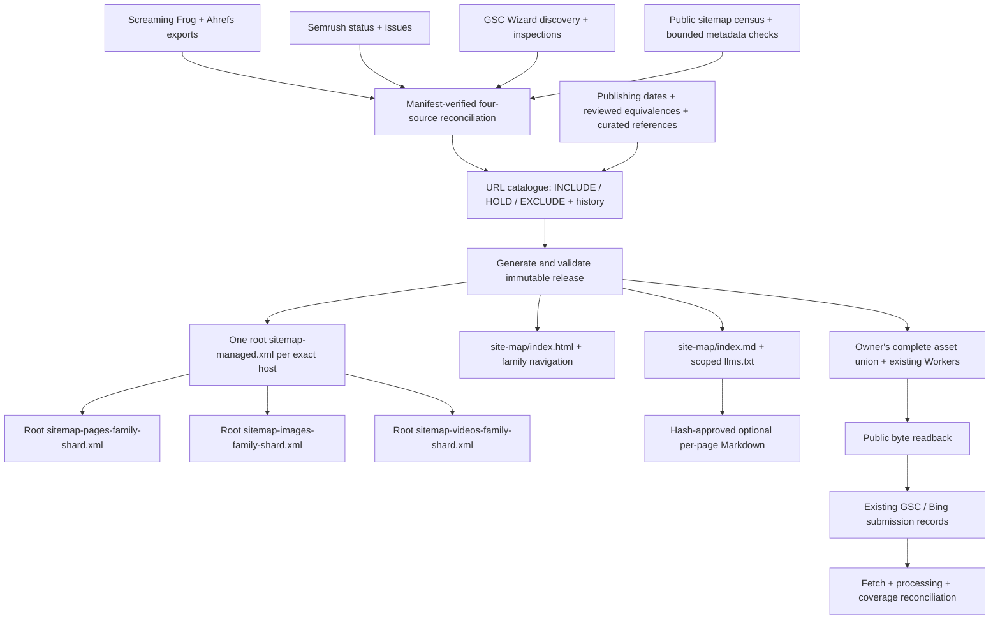

# Pinnacle sitemap manager

Repeatable, offline reconciliation and catalogue-backed releases. Python 3.11+
uses the standard library; the optional hosting adapter uses Node 24 / Workers
web APIs. No subscription purchase or new account is required to run it.

This package lives outside maintained website routing. The existing website
owner integrates and deploys it under [PORTAL-OWNERSHIP.md](../../PORTAL-OWNERSHIP.md).
Prepared files, a PR, public serving, engine processing and enquiry outcomes
are distinct acceptance steps.

## Architecture



The five exact hosts are in `policy.json`. Apex and www remain distinct.
Indexes reference leaf `urlset` files directly. All XML leaves are at the host
root, avoiding the subdirectory-scope issue for pages elsewhere. A human site map
connects families within its host; the existing root discovery and approved
`/llms.txt` are retained and receive owner-reviewed additions.

## Catalogue and field boundaries

`manager.py` creates SQLite `pages` and `receipts` tables automatically. The
optional matching PlanetScale/Vitess table is in `schema/planetscale.sql`.
URLs use SHA-256 identity, preserving path case, trailing slashes, query keys,
existing escapes and apex/www. Credentials and unexpected ports are rejected.
Every source input is hashed and every eligible decision retains dated evidence.

Columns include title, description, keywords, canonical URL, language, publishing
date, internal priority/frequency/relevance, OG candidate, image/video records,
links, draft LLM reference, approval state and provenance. Missing facts remain
empty. An OG candidate does not prove that an image appears on the page.
Inlink counts do not establish the actual destinations of links.

Page XML emits `loc`, evidenced `lastmod` and, when supplied, reciprocal approved
language alternates. Titles/descriptions/keywords remain catalogue/HTML/curation
fields; they are not invented sitemap tags. Both Google and Bing ignore
`priority` and `changefreq`; those stay internal. Crawl time and build time never
become page modification dates. Index modification dates are omitted because
a local build is not proof of a public child-file change.

Image XML emits current `image:image` / `image:loc` fields. Video XML validates
required thumbnail/title/description and media/player identity, lengths, dates,
duration, flags, tags and restriction attributes. Empty optional tags are omitted;
titles exceeding 100 characters are shortened at a word boundary and logged
with the original. Existing sitemap media is retained with source provenance;
that is not proof that every video is currently playable, prominent or eligible
for a video result. No news sitemap is generated without a qualifying dated
news-publishing inventory.

Draft LLM references can be stored for every row, but no per-page mirror is public
without review. Curation supplies `reviewed_sha256` for the exact public reference
and title/description/canonical/language values. Source changes invalidate it;
replaying an old curation file cannot sign new text. `llms.txt` is an optional
proposal, not an engine submission channel. No generic `ai-sitemap.xml` or
`llm-sitemap.xml` protocol is invented.

## Run and replay

For the first owner integration, `baseline/release-20261012.zip` is the reviewed
public candidate, with its hash and test/source receipt beside it. It contains
no SQL, catalogue or local input paths. Extract into a private release directory
and validate before assembly. Its 71,047 candidates replace the earlier 71,049
count: two obsolete Ask aliases redirect to canonical pages already included.

```sh
python -m zipfile -e tooling/sitemap-manager/baseline/release-20261012.zip private/release
python tooling/sitemap-manager/manager.py validate --release private/release
```

Create a private job JSON using `examples/job.json`. The example records the
12 October baseline; replace its paths, hashes, date and counts with the actual
reviewed input manifest. For each source, record its
path, SHA-256, observation date, expected rows and known coverage limit. Include
all GSC performance parts. The snapshot means the complete **collected exports**,
not a proven complete publishing estate. A prebuilt reviewed register may also
be supplied as role `register`; otherwise the portable reconciler builds it.

The job must declare expected union/decision counts. Unknown roles, missing
required sources, wrong hashes/counts, empty eligibility or unexpected per-host
loss fail before catalogue mutation. The default loss threshold is 5%; investigate
and document a legitimate change before changing it. A seven-day freshness limit
requires current eligibility evidence before a new release. Imports use a single
rollback transaction. Snapshot omissions become historical `HOLD` tombstones.
Reappearing identities regain active status, but do not regain LLM approval.

```sh
python tooling/sitemap-manager/run.py prepare \
  --job private/job.json --db private/catalogue.sqlite3 \
  --policy tooling/sitemap-manager/policy.json --output private/release
python tooling/sitemap-manager/manager.py validate --release private/release
python tooling/sitemap-manager/manager.py status --db private/catalogue.sqlite3
python -m unittest discover -s tooling/sitemap-manager/tests -v
node --test tooling/sitemap-manager/tests/asset-handler.test.mjs
```

Changing inputs and their verified manifest makes the next release. No URL count
is hardcoded in the generator. Families use stable hash buckets; oversized
shards split recursively at 50,000 URLs or 50 MiB uncompressed. Public output
hashes are reproducible from the same catalogue/policy in a fresh directory.
Failed validation preserves the previous output; `.previous` is a local recovery
copy, not an atomic production switch. Retain versioned release artifacts.

Optional independent XSD QA uses `validate_xsd.py --release private/release
--schema-dir private/official-schemas` with `lxml` already available. The saved
schema directory contains official sitemap, index, image and video XSDs; no
network access occurs during this check.

## Optional database synchronization

Keep this website catalogue separate from care, caller and employee tables.
The connected PlanetScale tool requires explicit human approval of the exact DDL
before table creation. It must not be bypassed through another route.

```sh
python tooling/sitemap-manager/manager.py export-mysql \
  --db private/catalogue.sqlite3 --output private/mysql-batches --batch-size 250
```

Exports contain UTF-8 hex literals and a clean ordered batch manifest. Consume
only named, hash-verified batches, with a scoped authenticated native MySQL route;
never upload SQL or the catalogue to public website assets. UPSERT is a delta
operation with explicit tombstones. Verify row hashes and current decision
counts after synchronization. The package does not claim cloud synchronization
merely because SQL was generated. Bulk connection credentials must remain in the
receiving environment, never source control or tool output.

## Integration and deployment acceptance

1. The existing owner refreshes the actual full asset union, Worker versions,
   routes and bindings. Prior dated directories are not a current baseline.
2. Call `handleManagedSitemap(request, env)` from the existing Worker routing,
   using its existing asset binding. It returns `null` for unrelated paths,
   existing `/robots.txt`, `/sitemap.xml`, `/llms.txt` and protected services.
   An absent binding or an HTML fallback pretending to be XML fails visibly.
3. Assemble into a **new** full asset directory. On later releases provide the
   exact prior manifest; only that verified managed namespace can be replaced
   or removed. Every unrelated baseline file must retain its hash.

```sh
python tooling/sitemap-manager/run.py assemble \
  --release private/release --asset-union private/current-full-assets \
  --output private/next-full-assets --receipt private/assembly.json
# Later: append --previous private/previous-release
```

4. Merge each host's `robots-addition.txt` and `llms-addition.txt` through existing
   owner-controlled discovery handlers. These are integration fragments, not
   replacement files. No index references another index.
5. Use the owner's current complete-manifest release procedure. Preserve routes,
   bindings, auth, consent and receiving API ownership. Never use a partial asset
   deployment or `--route`. Record source/CI/deployment/rollback identities.
6. Run public readback. Every generated public file must return direct HTTP 200,
   correct MIME and the expected bytes. Reverts must restore the previous complete
   Worker version and matching assets.

```sh
python tooling/sitemap-manager/run.py verify-public \
  --release private/release --receipt private/public-readback.json
python tooling/sitemap-manager/run.py change-queue \
  --db private/catalogue.sqlite3 --release private/release \
  --previous private/previous-release --receipt private/change-queue.json
```

7. After passing readback, submit the five host indexes through existing verified
   GSC/Bing properties. Check engine last-read/processing/errors. Reconcile and
   retire redundant legacy sources only after coverage and owner review.
   IndexNow complements XML for **proven** newly created/changed/deleted pages;
   an eligibility decision or sitemap rebuild alone is not such proof. The
   release-bound queue does not auto-send unverified changes.
8. Attach generation to the existing publishing/release pipeline; reconcile on
   source/eligibility changes and inspect meaningful failures. This package adds
   a scoped CI contract check, not a duplicate recurring scheduler. Search crawl,
   indexing, rankings and calls to `9100181181` remain separate measurements.

Primary guidance: [Google sitemap generation](https://developers.google.com/search/docs/crawling-indexing/sitemaps/build-sitemap),
[Google images](https://developers.google.com/search/docs/crawling-indexing/sitemaps/image-sitemaps),
[Google videos](https://developers.google.com/search/docs/crawling-indexing/sitemaps/video-sitemaps),
[Google AI features](https://developers.google.com/search/docs/appearance/ai-features),
[Bing sitemap freshness and processing](https://blogs.bing.com/webmaster/2025/7/Keeping-Content-Discoverable-with-Sitemaps-in-AI-Powered-Search/),
[llms.txt proposal](https://llmstxt.org/).
