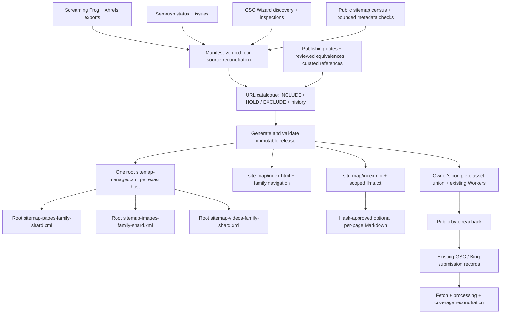

# Pinnacle sitemap manager

Repeatable, offline reconciliation and catalogue-backed releases. Python 3.11+
uses the standard library; the optional hosting adapter uses Node 24 / Workers
web APIs. No subscription purchase or new account is required to run it.

This package lives outside maintained website routing. The existing website
owner integrates and deploys it under [PORTAL-OWNERSHIP.md](../../PORTAL-OWNERSHIP.md).
Prepared files, a PR, public serving, engine processing and enquiry outcomes
are distinct acceptance steps.

## Architecture



The five exact hosts are in `policy.json`. Apex and www remain distinct.
Indexes reference leaf `urlset` files directly. All XML leaves are at the host
root, avoiding the subdirectory-scope issue for pages elsewhere. A human site map
connects families within its host; the existing root discovery and approved
`/llms.txt` are retained and receive owner-reviewed additions.

## Catalogue and field boundaries

`manager.py` creates SQLite `pages` and `receipts` tables automatically. The
optional matching PlanetScale/Vitess table is in `schema/planetscale.sql`.
URLs use SHA-256 identity, preserving path case, trailing slashes, query keys,
existing escapes and apex/www. Credentials and unexpected ports are rejected.
Every source input is hashed and every eligible decision retains dated evidence.

Columns include title, description, keywords, canonical URL, language, publishing
date, internal priority/frequency/relevance, OG candidate, image/video records,
links, draft LLM reference, approval state and provenance. Missing facts remain
empty. An OG candidate does not prove that an image appears on the page.
Inlink counts do not establish the actual destinations of links.

Page XML emits `loc`, evidenced `lastmod` and, when supplied, reciprocal approved
language alternates. Explicit versioned page profiles can emit optional
`priority`/`changefreq`; absent values are omitted. Titles/descriptions/keywords remain catalogue/HTML/curation
fields; they are not invented sitemap tags. Both Google and Bing ignore
`priority` and `changefreq`; their presence does not improve those engines' ranking.
Crawl time and build time never become page modification dates. Index `lastmod`
requires matching public child-file bytes, an actual modification date and a
public-verification receipt; a local build does not supply that evidence.

Image XML emits current `image:image` / `image:loc` fields. Video XML validates
required thumbnail/title/description and media/player identity, lengths, dates,
duration, flags, tags and restriction attributes. Empty optional tags are omitted;
titles exceeding 100 characters are shortened at a word boundary and logged
with the original. Existing sitemap media is retained with source provenance;
that is not proof that every video is currently playable, prominent or eligible
for a video result. News is conditional on a versioned, positively qualified
publication/article inventory. Only articles within the build's two-day window
are emitted, at most 1,000 per file; evergreen, stale and future articles are
omitted. New profiles use current documented fields, without legacy News tags.

Draft LLM references can be stored for every row, but no per-page mirror is public
without review. Curation supplies `reviewed_sha256` for the exact public reference
and title/description/canonical/language values. Source changes invalidate it;
replaying an old curation file cannot sign new text. `llms.txt` is an optional
proposal, not an engine submission channel. No generic `ai-sitemap.xml` or
`llm-sitemap.xml` protocol is invented.

## Run and replay

For the first owner integration, `baseline/release-20261012.zip` is the reviewed
public candidate, with its hash and test/source receipt beside it. It contains
no SQL, catalogue or local input paths. Extract into a private release directory
and validate before assembly. Its 71,047 candidates replace the earlier 71,049
count: two obsolete Ask aliases redirect to canonical pages already included.

```sh
python -m zipfile -e tooling/sitemap-manager/baseline/release-20261012.zip private/release
python tooling/sitemap-manager/manager.py validate --release private/release
```

Create a private job JSON using `examples/job.json`. The example records the
12 October baseline; replace its paths, hashes, date and counts with the actual
reviewed input manifest. For each source, record its
path, SHA-256, observation date, expected rows and known coverage limit. Include
all GSC performance parts. The snapshot means the complete **collected exports**,
not a proven complete publishing estate. A prebuilt reviewed register may also
be supplied as role `register`; otherwise the portable reconciler builds it.

The job must declare expected union/decision counts. Unknown roles, missing
required sources, wrong hashes/counts, empty eligibility or unexpected per-host
loss fail before catalogue mutation. The default loss threshold is 5%; investigate
and document a legitimate change before changing it. A seven-day freshness limit
requires current eligibility evidence before a new release. Imports use a single
rollback transaction. Snapshot omissions become historical `HOLD` tombstones.
Reappearing identities regain active status, but do not regain LLM approval.

```sh
python tooling/sitemap-manager/run.py prepare \
  --job private/job.json --db private/catalogue.sqlite3 \
  --policy tooling/sitemap-manager/policy.json --output private/release
python tooling/sitemap-manager/manager.py validate --release private/release
python tooling/sitemap-manager/manager.py status --db private/catalogue.sqlite3
python -m unittest discover -s tooling/sitemap-manager/tests -v
node --test tooling/sitemap-manager/tests/asset-handler.test.mjs
```

Changing inputs and their verified manifest makes the next release. No URL count
is hardcoded in the generator. Families use stable hash buckets; oversized
shards split recursively at 50,000 URLs or 50 MiB uncompressed. Public output
hashes are reproducible from the same catalogue/policy in a fresh directory.
Failed validation preserves the previous output; `.previous` is a local recovery
copy, not an atomic production switch. Retain versioned release artifacts.

Optional independent XSD QA uses `validate_xsd.py --release private/release
--schema-dir private/official-schemas` with `lxml` already available. The saved
schema directory contains official sitemap, index, image and video XSDs; no
network access occurs during this check.

## Optional database synchronization

### Reviewed publisher media exports

`r2_reconcile.py` verifies the selected R2/Ask manifests and the publisher input
hashes, joins only actual object identities and published answer-shard parents,
and creates a replayable candidate JSONL map. It distinguishes rendered PNG
candidates from SVG variants and unassociated hash-card objects. R2 modification
dates never become page `lastmod`. Unassociated images/videos remain in the
verified inventory, with no invented page binding, rights or deletion.

```sh
python tooling/sitemap-manager/r2_reconcile.py \
  --job private/r2-reconciliation-job.json \
  --output private/reconciled-media-candidates.jsonl \
  --receipt private/r2-reconciliation-receipt.json
```

The selected job pins the `r2_manifest`, `ask_manifest`, `publisher_media`,
`eligible_pages` and current public `answer_membership` file paths/hashes. Its
output is not a sitemap approval. Current publisher content versions, curation
overrides and actual rendered use still feed the normalized profile gates.

The optional pinned `html_snapshot` input adds real source-image/video joins from
anonymous resource HTML. `public_media_snapshot.py` collects only the accepted
Materials, Interventions and `/abs/` example pages with bounded concurrency;
compressed HTML and byte hashes are protected evidence. Unicode and encoded
canonical addresses normalize consistently. A missing optional canonical tag is
recorded as unknown; a conflicting canonical or noindex is an explicit hold.

`public_media_profiles.py` combines the verified candidate map, actual publisher
content fingerprints/curation overrides, current HTML placements, public image
HEAD evidence and the separately recorded human reference authorization. Its
review output records thumbnail selections and any editorial descriptions.
Unbound objects, noindex parents, unavailable images and generated/placeholder
video dates, durations or view counts are never silently approved.

```sh
python tooling/sitemap-manager/public_media_profiles.py \
  --review-job private/publication-review-job.json \
  --output private/reviewed-public-media.json \
  --receipt private/publication-review-receipt.json
python tooling/sitemap-manager/public_media_profiles.py \
  --db private/candidate-catalogue.sqlite3 \
  --source private/reviewed-public-media.json \
  --source-sha256 '<selected-reviewed-source-sha256>' \
  --receipt private/public-media-profile-receipt.json
```

The normalized projection connects original and rendered renditions to the same
logical asset, binds every active use/profile to its actual current page version,
preserves prior source/placement history and deduplicates image output per page.
The apply command is transactional. It does not publish or load the optional
cloud mirror; production serving still requires the existing owner's release.

`publisher_media.py` imports the website owner's hash-verified public page/media
export into the existing private normalized catalogue. Supply the accepted
transfer-manifest SHA256 and its actual observation timestamp. All file hashes,
row accounting and the exact eligible-page set must match before commit.

```sh
python tooling/sitemap-manager/publisher_media.py \
  --db private/catalogue.sqlite3 \
  --manifest private/publisher-export/TRANSFER-MANIFEST.json \
  --manifest-sha256 <accepted-transfer-manifest-sha256> \
  --observed-at <actual-offset-qualified-observation-time> \
  --receipt private/publisher-media-import.json
```

Image, video, player and poster references retain their distinct source roles.
Unknown parents or unparsed source values stay in hashed evidence. Replays are
idempotent; no omitted record becomes a deletion and no candidate gains rights,
page-version or public sitemap approval merely through import. Complete R2 and
publisher coverage remains a separate acceptance gate.

The changed/deleted-record fixture also exercises later-release assembly and
last-valid rollback while preserving holds and every unrelated asset byte. This
is local contract proof. Live automatic maintenance still requires the existing
website owner to connect real publisher signals to generation, composition,
matching Worker/routes/discovery publication and readback. The initial pinned
release driver must not be replayed as a recurring deployment script.

### Normalized catalogue and the single work order

The [work order](work-order.json) is the accountable queue for this ecosystem.
Each item names its owner, dependency, next action and validation criterion.
Render it with `python tooling/sitemap-manager/work_order.py --html private/work-order.html`.
Do not mark native storage, public serving or engine processing complete from an
offline file or a passing test.

`catalogue_v2.py` implements the reviewed normalized model in
`schema/catalogue-v2.contract.json`: 27 catalogue/standards tables plus four
claim, claim-evidence, review and contributor tables. SQLite enables deferred
foreign keys and composite media/rendition ownership. The existing PlanetScale
database has foreign keys disabled; the importer and readback validator enforce
identity/provenance/relationship integrity without changing that setting.
Optional descriptive fields retain NULL. `editorial-policy.json` defines the
36 population rules, 10 family profiles and scoped evidence/review requirements.
`brand-profile.json` carries the shared, source-linked organisation/contact
identity; it is not a clinical byline or a new outcome claim.

```sh
python tooling/sitemap-manager/catalogue_v2.py schema --output private/schema
python tooling/sitemap-manager/catalogue_v2.py import \
  --legacy-db private/catalogue.sqlite3 \
  --candidate-media private/page-image-candidates.jsonl \
  --db private/catalogue-v2.sqlite3 --receipt private/import-v2.json \
  --expected-decisions private/job.json
python tooling/sitemap-manager/catalogue_v2.py seed \
  --db private/catalogue-v2.sqlite3 \
  --registry private/standards-property-registry.json \
  --receipt private/dictionary-v2.json
python tooling/sitemap-manager/catalogue_v2.py validate --db private/catalogue-v2.sqlite3
python tooling/sitemap-manager/catalogue_v2.py export-generator \
  --db private/catalogue-v2.sqlite3 --output private/generator-projection.sqlite3 \
  --receipt private/projection.json
python tooling/sitemap-manager/manager.py build \
  --db private/generator-projection.sqlite3 \
  --policy tooling/sitemap-manager/policy.json --output private/release
```

The importer freezes a SQLite backup, including committed WAL records, hashes
and retains that source artifact, and imports one consistent snapshot. It rejects
input/output/receipt aliases, active destination sidecars, conflicting immutable
replays, missing provenance and invalid decisions. Candidate associations with
unmapped parents remain evidence with reconciled counts. They never silently
become approved images. The compatibility projection requires one accepted
page-sitemap decision per current URL; conflicting versions need explicit
resolution. The existing generator continues to enforce canonical, freshness,
media and public-text approval rules.

Store the SQLite database, frozen sources, row exports and receipts outside
public website assets and this repository. The 31-table MySQL DDL is a review
artifact. Human approval of its exact statements and native schema/readback
evidence precede cloud acceptance. Native bulk synchronization requires a scoped
authenticated route in the receiving environment; generated SQL is not proof
that rows were synchronized.

The compatibility projection preserves existing imported public-sitemap media.
Use `export-generator --normalized-profiles` or the repeatable wrapper below to
render the normalized image/video/page/news and approved translation profiles.
Existing imported references retain their declared baseline scope. New media
requires an approved public use, matching published page version, rights status
and exactly one channel INCLUDE for that version. Source/evidence mismatches,
candidate profiles and stale translations fail validation. No dates or authors
are invented. Whole-library/source and actual content reviews remain dependencies.

```sh
python tooling/sitemap-manager/catalogue_v2.py build-normalized \
  --db private/catalogue-v2.sqlite3 --projection private/projection.sqlite3 \
  --policy tooling/sitemap-manager/policy.json --output private/public-release \
  --receipt private/normalized-build.json
```

The wrapper retains a frozen input snapshot, generates the validated private
projection, composes verified public-file modification evidence and builds the
public release. Database/projection/policy/receipt paths must remain outside the
public output directory. `public_verified` publication rows require an actual
coverage receipt. Applicable conditional profiles must be approved/populated;
an empty News inventory produces no News file. This is technical eligibility,
not a guarantee of rich results or indexing.

`import-public-media --db private/catalogue-v2.sqlite3 --source private/cms-media.json
--receipt private/cms-import.json` imports dedicated media metadata only from the
declared public `faq`, `sunshine` and `guru` sources. Each source artifact declares
its date, scope, row count and rows. It accounts for unmapped parents and unparsed
fields without promotion. Root-relative paths need a separate, source-linked
resolution artifact with the documented publishing origin; do not guess image
locations or treat a declared image field as pixel/rights verification.

```sh
python tooling/sitemap-manager/catalogue_v2.py resolve-relative-media \
  --source private/cms-media.json --origin https://www.pinnacleblooms.org/ \
  --evidence private/origin-evidence.json --output private/cms-resolved.json \
  --receipt private/resolution.json
python tooling/sitemap-manager/catalogue_v2.py export-mysql-v2 \
  --db private/catalogue-v2.sqlite3 --output private/mysql-v2-export \
  --receipt private/mysql-v2-export.json
```

The normalized export freezes and validates the source, then creates at most
500-row/4-MiB batches with UTF-8 hex literals. The private manifest declares the
approved schema hash, each batch hash, exact table counts and ordered row hashes.
JSON cells are parsed and canonically serialized for row hashing, so JSON key
order/spacing does not cause a false native mismatch. The receiving environment
must verify every named batch before applying it with its existing scoped native
connection, then read all columns in primary-key order, canonicalize JSON in the
same way and reconcile row hashes/counts plus logical references. UPSERT retains
history; it never implicitly deletes missing records. A new export directory is
required. SQL generation is not native data loading or validation.

Keep this website catalogue separate from care, caller and employee tables.
The connected PlanetScale tool requires explicit human approval of the exact DDL
before table creation. It must not be bypassed through another route.

```sh
python tooling/sitemap-manager/manager.py export-mysql \
  --db private/catalogue.sqlite3 --output private/mysql-batches --batch-size 250
```

Exports contain UTF-8 hex literals and a clean ordered batch manifest. Consume
only named, hash-verified batches, with a scoped authenticated native MySQL route;
never upload SQL or the catalogue to public website assets. UPSERT is a delta
operation with explicit tombstones. Verify row hashes and current decision
counts after synchronization. The package does not claim cloud synchronization
merely because SQL was generated. Bulk connection credentials must remain in the
receiving environment, never source control or tool output.

## Integration and deployment acceptance

1. The existing owner refreshes the actual full asset union, Worker versions,
   routes and bindings. Prior dated directories are not a current baseline.
2. Call `handleManagedSitemap(request, env)` from the existing Worker routing,
   using its existing asset binding. It returns `null` for unrelated paths,
   existing `/robots.txt`, `/sitemap.xml`, `/llms.txt` and protected services.
   An absent binding or an HTML fallback pretending to be XML fails visibly.
3. Assemble into a **new** full asset directory. On later releases provide the
   exact prior manifest; only that verified managed namespace can be replaced
   or removed. Every unrelated baseline file must retain its hash.

```sh
python tooling/sitemap-manager/run.py assemble \
  --release private/release --asset-union private/current-full-assets \
  --output private/next-full-assets --receipt private/assembly.json
# Later: append --previous private/previous-release
```

4. Merge each host's `robots-addition.txt` and `llms-addition.txt` through existing
   owner-controlled discovery handlers. These are integration fragments, not
   replacement files. No index references another index.
5. Use the owner's current complete-manifest release procedure. Preserve routes,
   bindings, auth, consent and receiving API ownership. Never use a partial asset
   deployment or `--route`. Record source/CI/deployment/rollback identities.
6. Run public readback. Every generated public file must return direct HTTP 200,
   correct MIME and the expected bytes. Reverts must restore the previous complete
   Worker version and matching assets.

```sh
python tooling/sitemap-manager/run.py verify-public \
  --release private/release --receipt private/public-readback.json
python tooling/sitemap-manager/run.py change-queue \
  --db private/catalogue.sqlite3 --release private/release \
  --previous private/previous-release --receipt private/change-queue.json
```

7. After passing readback, submit the five host indexes through existing verified
   GSC/Bing properties. Check engine last-read/processing/errors. Reconcile and
   retire redundant legacy sources only after coverage and owner review.
   IndexNow complements XML for **proven** newly created/changed/deleted pages;
   an eligibility decision or sitemap rebuild alone is not such proof. The
   release-bound queue does not auto-send unverified changes.
8. Attach generation to the existing publishing/release pipeline; reconcile on
   source/eligibility changes and inspect meaningful failures. This package adds
   a scoped CI contract check, not a duplicate recurring scheduler. Search crawl,
   indexing, rankings and calls to `9100181181` remain separate measurements.

Primary guidance: [Google sitemap generation](https://developers.google.com/search/docs/crawling-indexing/sitemaps/build-sitemap),
[Google images](https://developers.google.com/search/docs/crawling-indexing/sitemaps/image-sitemaps),
[Google videos](https://developers.google.com/search/docs/crawling-indexing/sitemaps/video-sitemaps),
[Google AI features](https://developers.google.com/search/docs/appearance/ai-features),
[Bing sitemap freshness and processing](https://blogs.bing.com/webmaster/2025/7/Keeping-Content-Discoverable-with-Sitemaps-in-AI-Powered-Search/),
[llms.txt proposal](https://llmstxt.org/).
